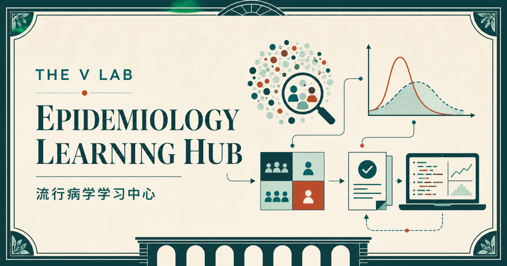

# The V Lab Epidemiology Learning Hub

[](https://laboratoirev.github.io/Epidemiology_Study/)

An epidemiology learning website for students and practitioners in public health, medicine, and health data science. Its three modules start with population thinking and develop a practical understanding of disease frequency, study design, bias and confounding, screening, outbreak investigation, causal inference, advanced epidemiologic methods, and reproducible analysis in R.

## Learn online

- [Course home: Epidemiology Learning Hub](https://laboratoirev.github.io/Epidemiology_Study/)
- [Guide: Foundations of Epidemiology](https://laboratoirev.github.io/Epidemiology_Study/epidemiology_basics_en.html)
- [Guide: Epidemiologic Research Designs](https://laboratoirev.github.io/Epidemiology_Study/epidemiology_research_designs_en.html)
- [Guide: Advanced Epidemiologic Methods](https://laboratoirev.github.io/Epidemiology_Study/epidemiology_advanced_methods_en.html)

## What you will learn

- distinguish prevalence, cumulative incidence, incidence rate, risk, odds, and person-time;
- calculate and interpret risk ratios, odds ratios, rate ratios, risk differences, and confidence intervals;
- match cross-sectional, case-control, cohort, ecological, and experimental designs to research questions;
- recognize selection bias, information bias, confounding, effect modification, and random error;
- evaluate screening and diagnostic tests, including how prevalence affects predictive values;
- outline surveillance, outbreak investigation, DAG, and target-trial reasoning workflows;
- use R for data checks, descriptive analysis, introductory regression, and reproducible reporting;
- turn common research topics into clear, ethical, and answerable questions;
- compare common study types by question, strengths, limitations, and likely biases;
- define target and source populations, construct sampling frames, and choose probability or non-probability sampling methods;
- develop a protocol covering sample size, recruitment, measurement, quality control, ethics, and analysis planning; and
- apply survival and competing-risk analysis, modern causal-effect estimation, missing-data methods, transportability methods, and quantitative bias analysis.

## Repository contents

- `index.html`: learning-hub home and course navigation.
- `epidemiology_basics_en.html`: complete foundations guide.
- `epidemiology_research_designs_en.html`: guide to study design, study types, and sampling.
- `epidemiology_advanced_methods_en.html`: guide to advanced epidemiologic methods.
- `styles.css`: shared branding, mobile, and print styles for all six guides.
- `includes/vlab-brand.html`: The V Lab home link shown above each guide.
- `og-learning-hub.png`: social-sharing preview image.
- `render.R`: rebuilds the HTML guides when local Rmd sources are present.
- `.nojekyll`: publishes the static files unchanged through GitHub Pages.
- `README.md`: project documentation.

## Local sources and rendering

> **Important:** The `.Rmd` source files remain only in the local working copy and are excluded by `.gitignore`. They are not uploaded to GitHub or published as website files. The public repository contains only the generated HTML.

To rebuild the guides in a working copy that contains the local Rmd files, install R, Pandoc (or RStudio), and these R packages:

```r
install.packages(c("rmarkdown", "knitr"), repos = "https://cloud.r-project.org")
```

Then run this command from the project root:

```bash
Rscript render.R
```

`render.R` discovers Rmd files in the project root, locates an available Pandoc installation, and produces same-named HTML files. In a public clone without Rmd sources, it exits safely without modifying the website.

For an isolated local package library, you may use the Git-ignored `.Rlib` directory:

```r
dir.create(".Rlib", showWarnings = FALSE)
install.packages(c("rmarkdown", "knitr"), lib = ".Rlib",
                 repos = "https://cloud.r-project.org")
```

## Reproducibility and privacy

The teaching examples use simulated data, aggregate data, or datasets distributed with R. They contain no real personal health information. The material is educational and does not replace a research protocol, statistical analysis plan, ethics review, clinical judgment, or local public-health guidance.

The website is deployed as static files from the root of the `main` branch through GitHub Pages. It requires no server-side code or external database.
